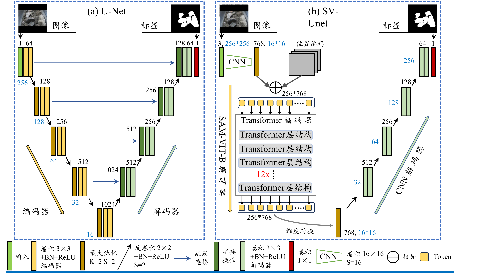
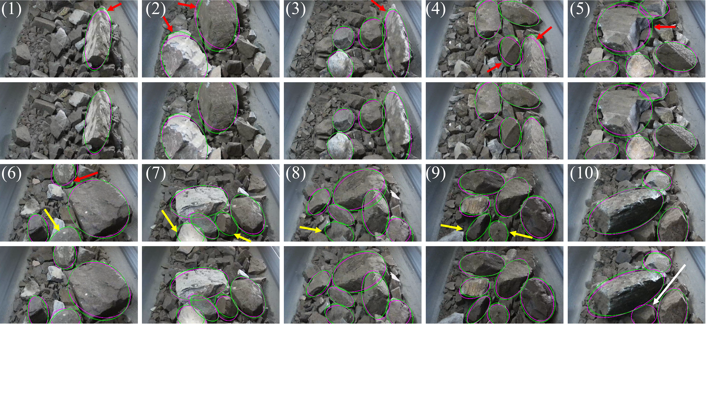
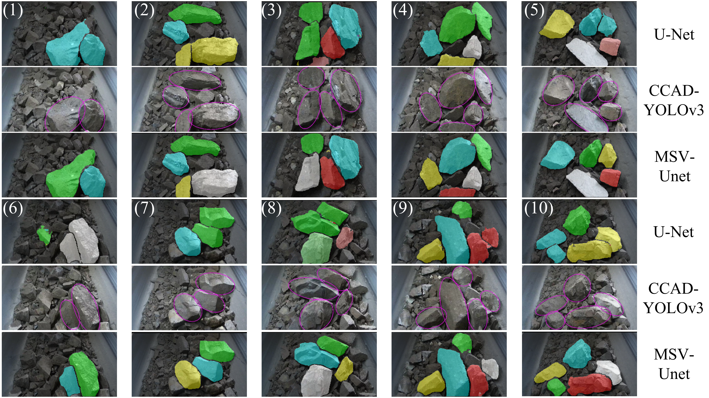

# 矿石语义分割数据集

## 数据集简介

本数据集用于论文 **《Oversized ore segmentation using SAM-enhanced U-Net with self-supervised pre-training and semi-supervised self-training》** 中的实验与研究。


## 论文信息

- **论文标题**：Oversized ore segmentation using SAM-enhanced U-Net with self-supervised pre-training and semi-supervised self-training
- **作者**：Wei Wang, Chong Yu, Tengyu Zhang, Feiyu Chen, Yufan Liu, Yaqi Liu, Zongze Wu
- **期刊**：Expert Systems with Applications
- **卷号**：285
- **页码**：127980
- **年份**：2025
- **DOI**：https://doi.org/10.1016/j.eswa.2025.127980
- **论文链接**：https://www.sciencedirect.com/science/article/pii/S095741742501601X

## 可视化与模型结构

### 网络结构



*图 1：SAM-enhanced U-Net with self-supervised pre-training and semi-supervised self-training 网络结构示意图。*

### 旋转目标检测结果



*图 2：矿石旋转目标检测结果示例。*

### 语义分割结果



*图 3：矿石语义分割结果示例。*

## 引用要求

如果您在研究、论文、报告或其他工作中使用了本数据集，请引用以下论文：

```bibtex
@article{WANG2025127980,
  title = {Oversized ore segmentation using SAM-enhanced U-Net with self-supervised pre-training and semi-supervised self-training},
  journal = {Expert Systems with Applications},
  volume = {285},
  pages = {127980},
  year = {2025},
  issn = {0957-4174},
  doi = {https://doi.org/10.1016/j.eswa.2025.127980},
  url = {https://www.sciencedirect.com/science/article/pii/S095741742501601X},
  author = {Wei Wang and Chong Yu and Tengyu Zhang and Feiyu Chen and Yufan Liu and Yaqi Liu and Zongze Wu}
}
